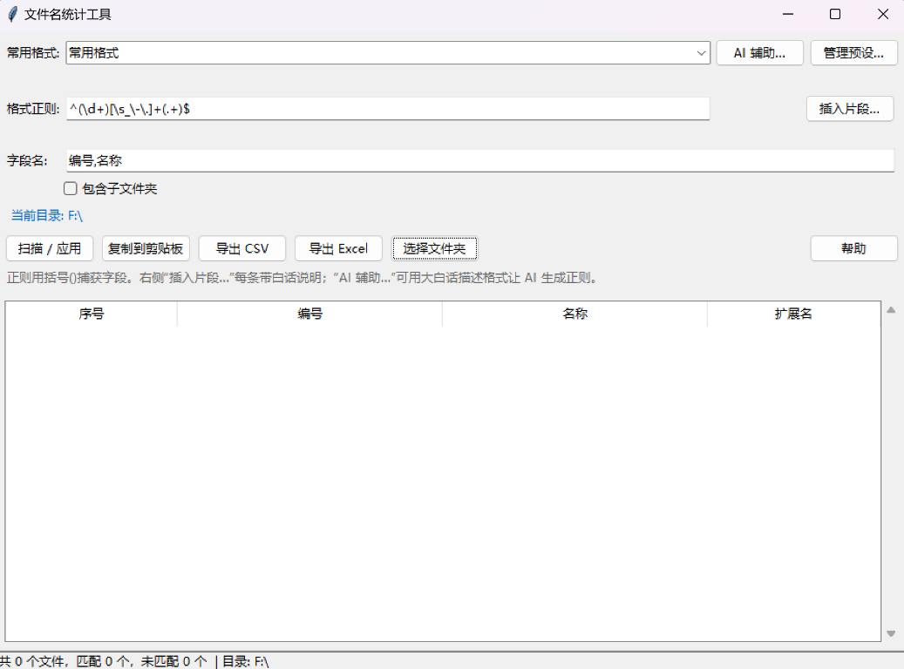

# 文件名统计工具

<p align="center">
  <b>把格式化文件名（如 123_会议记录.pdf）批量提取成表格，一键粘贴进 Excel。</b><br>
  不写正则 · 预设下拉 · 中文友好 · 便携单文件 exe · 零依赖
</p>

<p align="center">
  <a href="https://github.com/Asfl0/filename-stats/releases/latest"></a>
  <a href="https://github.com/Asfl0/filename-stats/blob/main/LICENSE"></a>
  
  
</p>

<p align="center">
  
</p>

---

## 下载（免安装）

前往 [**Releases**](https://github.com/Asfl0/filename-stats/releases/latest) 下载，选一个即可：

| 文件 | 说明 |
|---|---|
| `filename-stats.exe` | **图形界面版**。下载后重命名为 `文件名统计.exe`，双击即用 |
| `filename-stats-cli.exe` | 命令行版 |

> 单文件便携，无需安装 Python。把它复制到要统计的文件夹里双击运行即可。

## 这是什么

面对一堆「数字 + 汉字」规律命名的文件（`123_会议记录.pdf`、`12-合同.docx`、`8.报告.xlsx`…），
想快速把它们拆成「编号 / 名称」等字段、整理进 Excel 时，通常要写脚本或手动抄。

本工具把这件事变成：**选一个「人话模板」→ 点扫描 → 复制到 Excel**。
完全不用懂正则；想自定义也能用大白话描述让 AI 帮你写出正则。

## 特性

- **不写正则就能用**：8 条内置「常用格式」预设，下拉即选、自动填好正则与字段。
- **插入片段**：不知道正则怎么写？从片段库里点选插入（数字、汉字、日期、括号…）。
- **AI 辅助**：接任意 OpenAI 兼容接口，用大白话描述文件名格式 → 自动生成正则。
- **AI 样本模式**：不用你描述——读当前目录几个真实文件名，让 AI 自己判断该用什么正则。
- **中文文件名友好**：数字 / 汉字混合名解析是核心场景。
- **直接出表**：复制到剪贴板（UTF-8 + 制表符，Excel 直接粘），或导出 CSV / XLSX。
- **便携单文件**：`文件名统计.exe` 双击即用，无需安装 Python。
- **零第三方依赖**：AI 调用走标准库 `urllib`；仅 XLSX 导出用内置打包的 openpyxl。

## 快速使用

把 `文件名统计.exe` 复制到要统计的文件夹，双击运行：

1. 顶部「**常用格式**」下拉框选一个模板（如 `数字_名称`），正则与字段会**自动填好**；
2. 点「**扫描 / 应用**」；
3. 点「**复制到剪贴板**」，到 Excel 选中 A1 单元格 `Ctrl+V`。

也可以点「选择文件夹」切换统计目标，或勾选「包含子文件夹」。

## 常用格式预设

预设把正则藏起来，你看到的是人话模板。GUI 用下拉框选，CLI 用 `--preset`：

| 预设名 | 示例文件名 | 字段 |
|---|---|---|
| 数字_名称 | `123_会议记录` `12-合同` `8.报告` | 编号,名称 |
| 数字 空格 名称 | `123 会议记录` | 编号,名称 |
| 名称_v版本 | `报告_v3` | 名称,版本 |
| 数字_名称_版本 | `12_报告_v3` | 名称,版本 |
| 日期_名称 | `20240101_合同` | 日期,名称 |
| 括号编号 名称 | `(12) 报告` | 编号,名称 |
| 名称（整串不拆分） | `任意文件名` | 名称 |

- **GUI**：下拉框选择即**直接替换**正则/字段；点「管理预设…」可新增/删除自定义预设。
- **CLI**：`--list-presets` 查看，`--preset 名称` 或 `--preset 编号` 使用。

## AI 辅助

在 GUI 里点「AI 辅助」，填写任意 OpenAI 兼容服务的 `Base URL` / `API Key` / `模型`，然后：

- **描述模式**：在「提问」里用大白话描述你的文件名格式 → 点「生成正则」；
- **样本模式**：点「用样本自动生成」，工具会读当前目录几个真实文件名交给 AI 自行判断格式；
- 生成后点「检测语法」本地校验，再「插入到正则框」；满意的可直接「存为预设…」。
- **AI 设置默认收起**，点左侧三角展开填写；系统提示词也在设置里，一般无需修改。

配置文件 `config.json`（与程序同级）保存预设与 AI 设置，**其中 api_key 为明文**，请勿随仓库分发。

## 命令行版

```powershell
文件名统计_cli.exe --list-presets                 # 列出全部预设
文件名统计_cli.exe --preset 数字_名称 --dump       # 用预设扫描当前目录，输出制表符表格
文件名统计_cli.exe --ai-sample --sample-count 8    # 采样交给 AI 自动判断格式
文件名统计_cli.exe --ai-desc "数字_名称_版本"       # 用描述让 AI 生成正则
```

## 从源码构建

要求：Windows。首次构建会自动下载便携 Python（无需系统装 Python）。

```powershell
cd build
.\build.bat            # 或：  ..\build\python\python.exe build.py rebuild
```

产物在 `output/`：
- `文件名统计.exe` — GUI 单文件版
- `文件名统计_cli.exe` — 命令行版

## 目录结构

```
文件名统计/
├─ build/                     构建相关（源码 + 脚本 + 便携工具链）
│   ├─ src/                   源码（二次开发从这里改，按职责分层）
│   │   ├─ file_source.py     获取文件名（IO 层：枚举目录、排除自身）
│   │   ├─ name_parser.py     解析文件名（纯逻辑层：正则捕获字段）
│   │   ├─ pattern_presets.py 常用格式预设 + 插入片段
│   │   ├─ ai_helper.py       AI 辅助（OpenAI 兼容接口，含文件名采样）
│   │   ├─ app_config.py      统一配置（config.json：预设 + AI 设置，含旧文件迁移）
│   │   ├─ core.py            编排层：拼装各层 + 排序 / TSV 输出
│   │   ├─ app_gui.py         图形界面版
│   │   ├─ app_cli.py         命令行 / 菜单版
│   │   └─ main.py            打包入口
│   ├─ build.py               一键构建脚本（Makefile 风格）
│   ├─ build.bat              双击构建入口（纯 ASCII）
│   └─ python/                工程自带便携 Python（首次构建自动下载）
│
├─ output/                    编译产物（构建生成，不入库）
├─ assets/                    图标等资源（可选）
└─ README.md
```

## 相关链接

- 仓库：https://github.com/Asfl0/filename-stats
- 下载：https://github.com/Asfl0/filename-stats/releases/latest
- 问题反馈：https://github.com/Asfl0/filename-stats/issues

## 许可证

[MIT](LICENSE)
